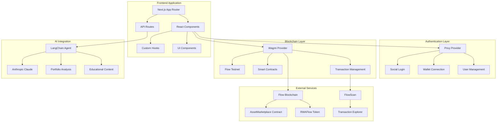
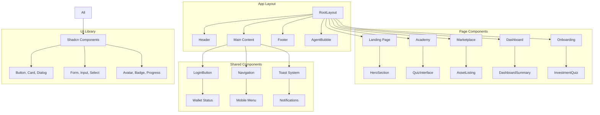
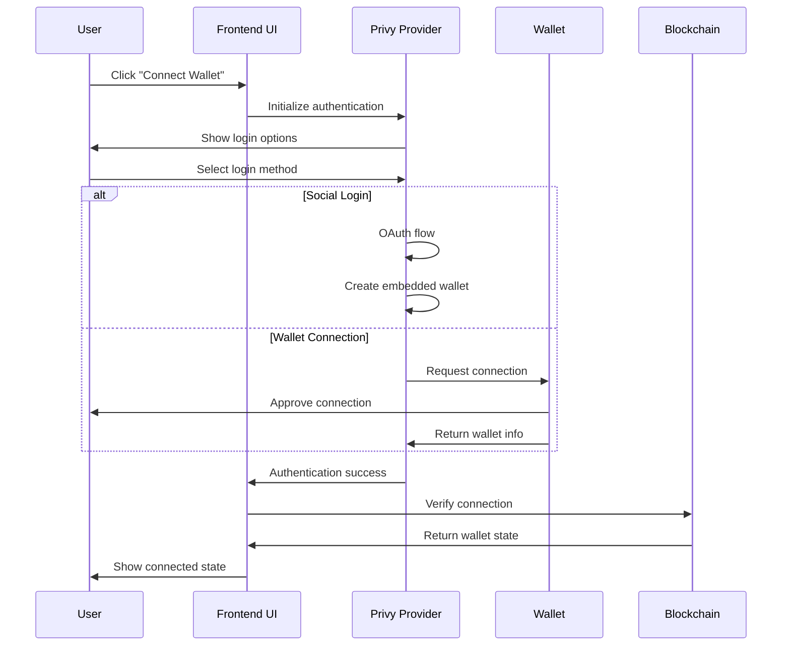
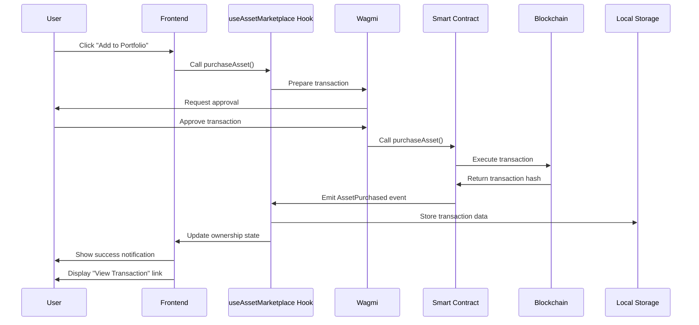
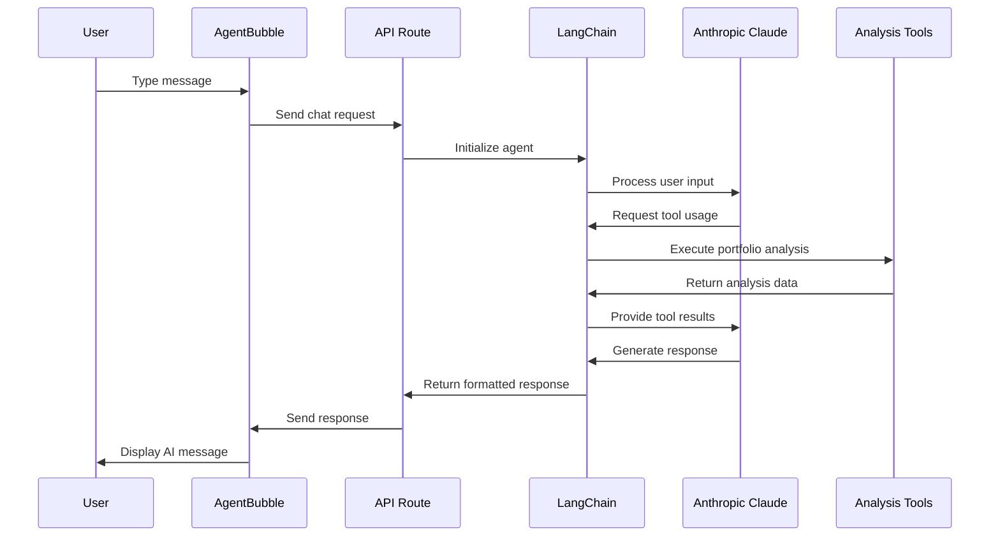
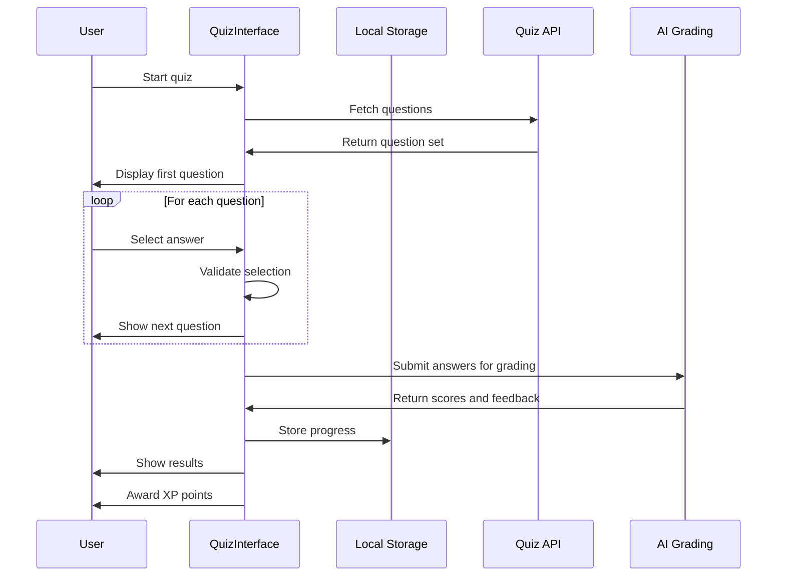

# Flow Passport Frontend Application

Flow Passport's frontend application is a cutting-edge **Next.js 15 dApp** that delivers a comprehensive DeFi education and tokenized asset marketplace experience. Built with modern React patterns, blockchain integration, and AI-powered features, it provides users with an intuitive gateway to Real World Asset (RWA) investment opportunities.

## 🏗️ Architecture Overview

### High-Level System Architecture



### Component Architecture Diagram



## 📁 Project Structure

```
RWAFlowApp/
├── app/                          # Next.js App Router
│   ├── academy/                  # 🎓 Educational Platform
│   │   ├── module/[moduleId]/    # Dynamic quiz modules
│   │   ├── modules/              # Module selection
│   │   └── page.tsx             # Academy dashboard
│   ├── api/                     # 🤖 Backend API Routes
│   │   └── agent/               # AI agent endpoints
│   │       ├── chat/            # Real-time chat
│   │       └── portfolio-recommendation/ # Investment AI
│   ├── marketplace/             # 🏪 Asset Marketplace
│   ├── onboarding/             # ✨ User Onboarding
│   ├── plan/                   # 📋 Investment Plans
│   ├── layout.tsx              # Root layout with providers
│   ├── page.tsx                # Landing page
│   └── globals.css             # Global styles
├── components/                  # 🧩 Reusable Components
│   ├── ui/                     # Shadcn/UI library (50+ components)
│   ├── agent-bubble.tsx        # Floating AI assistant
│   ├── asset-listing.tsx       # Marketplace listings
│   ├── dashboard-summary.tsx   # Portfolio dashboard
│   ├── header.tsx              # Main navigation
│   ├── hero-section.tsx        # Landing hero
│   ├── login-button.tsx        # Auth component
│   └── quiz-interface.tsx      # Interactive quizzes
├── hooks/                      # 🎣 Custom React Hooks
│   ├── use-auth.ts            # Authentication state
│   ├── use-asset-marketplace.ts # Blockchain interactions
│   └── use-toast.ts           # Toast notifications
├── lib/                       # 📚 Utility Libraries
│   ├── agent-config.ts        # AI configuration
│   └── utils.ts               # Helper functions
├── providers/                 # 🔗 Context Providers
│   ├── privy-provider.tsx     # Auth provider wrapper
│   └── wagmi-config.ts        # Blockchain configuration
└── public/                    # 📄 Static Assets
    ├── images/                # UI images and icons
    └── assets/                # Brand assets
```

## 🔄 Data Flow Architecture

### Authentication Flow Diagram



### Asset Purchase Flow Diagram



### AI Agent Interaction Flow



### Educational Quiz Flow



## 🛠️ Technology Stack

### Frontend Framework
```json
{
  "core": {
    "next": "15.2.4",
    "react": "^19",
    "typescript": "^5",
    "tailwindcss": "^3.4.17"
  }
}
```

### Authentication & Wallet
```json
{
  "auth": {
    "@privy-io/react-auth": "^2.16.0",
    "@privy-io/wagmi": "^1.0.4"
  }
}
```

### Blockchain Integration
```json
{
  "blockchain": {
    "wagmi": "^2.15.6",
    "viem": "^2.31.4",
    "@tanstack/react-query": "^5.81.2"
  }
}
```

### AI Integration
```json
{
  "ai": {
    "@ai-sdk/anthropic": "^1.2.12",
    "@langchain/anthropic": "^0.3.23",
    "@langchain/core": "^0.3.61",
    "langchain": "^0.3.29"
  }
}
```

### UI Components
```json
{
  "ui": {
    "@radix-ui/react-*": "Latest",
    "lucide-react": "^0.454.0",
    "class-variance-authority": "^0.7.1",
    "tailwind-merge": "^2.5.5"
  }
}
```

## 🎯 Key Features

### 🎓 Educational Platform
- **Interactive Quizzes**: Timed assessments with instant feedback
- **Progress Tracking**: XP points and achievement system
- **Adaptive Learning**: AI-powered content recommendations
- **Certification System**: NFT evolution based on progress

### 🤖 AI-Powered Assistant
- **Real-time Chat**: Floating bubble interface
- **Portfolio Analysis**: Investment recommendations
- **Risk Assessment**: Personalized risk profiling
- **Educational Guidance**: Context-aware learning support

### 🏪 Asset Marketplace
- **5 Tokenized Assets**: Real estate, NFTs, commodities, bonds
- **Smart Contract Integration**: Secure blockchain transactions
- **Ownership Tracking**: Real-time portfolio updates
- **Transaction History**: FlowScan integration

### 💳 Wallet Integration
- **Multi-Login Support**: Social login + wallet connection
- **Embedded Wallets**: Automatic wallet creation
- **Balance Tracking**: Real-time FLOW token balances
- **Transaction Monitoring**: Confirmation status updates

## 🔧 Development Setup

### Prerequisites
```bash
# Node.js 18+ (v23 supported with warnings)
node --version

# Package manager
npm --version
# or
yarn --version
```

### Installation
```bash
# Clone repository
git clone <repository-url>
cd Flow-Passport/RWAFlowApp

# Install dependencies
npm install

# Copy environment file
cp .env.example .env
```

### Environment Configuration
```env
# Contract Addresses
NEXT_PUBLIC_ASSET_MARKETPLACE_CONTRACT_ADDRESS=0xc7403912b47Bd062E1933D40027088ACD5066deD
NEXT_PUBLIC_RWAFLOW_TOKEN_ADDRESS=0x6fBD4A26B44046716e37cD93Db5c47832E276AeB

# Flow Network
NEXT_PUBLIC_FLOW_TESTNET_RPC=https://testnet.evm.nodes.onflow.org
NEXT_PUBLIC_FLOW_TESTNET_CHAIN_ID=545

# Platform Configuration
USD_TO_FLOW_RATE=3

# Privy Authentication
NEXT_PUBLIC_PRIVY_APP_ID=your_privy_app_id

# AI Integration (Optional)
ANTHROPIC_API_KEY=your_anthropic_key
```

### Development Commands
```bash
# Start development server
npm run dev

# Build for production
npm run build

# Start production server
npm start

# Run type checking
npm run type-check

# Run linting
npm run lint
```

## 📱 User Experience Flows

### New User Onboarding
1. **Landing Page**: Hero section with value proposition
2. **Start Journey**: Click "Start Your Investment Journey"
3. **Authentication**: Social login or wallet connection via Privy
4. **Risk Assessment**: Multi-step investment profile quiz
5. **Plan Generation**: AI-powered personalized recommendations
6. **Academy Access**: Educational content unlocked
7. **Marketplace Entry**: Asset investment opportunities

### Investment Journey
1. **Wallet Connection**: Secure authentication
2. **Asset Discovery**: Browse curated marketplace
3. **Due Diligence**: Asset details and risk analysis
4. **Purchase Decision**: Smart contract transaction
5. **Portfolio Tracking**: Real-time performance monitoring
6. **Transaction History**: FlowScan block explorer links

### Learning Experience
1. **Academy Dashboard**: Module selection
2. **Quiz Participation**: Interactive timed assessments
3. **Progress Tracking**: XP points and NFT evolution
4. **AI Assistance**: Real-time help and guidance
5. **Achievement System**: Badges and certifications

## 🔐 Security Features

### Authentication Security
- **OAuth 2.0**: Secure social login integration
- **Wallet Signatures**: Cryptographic user verification
- **Session Management**: Secure token handling
- **Multi-Factor Options**: Enhanced security layers

### Blockchain Security
- **Contract Validation**: Pre-transaction verification
- **User Confirmation**: Explicit approval flows
- **Transaction Monitoring**: Real-time status tracking
- **Error Handling**: Comprehensive failure recovery

### Data Protection
- **Local Storage Encryption**: Sensitive data protection
- **API Security**: Rate limiting and validation
- **XSS Protection**: Input sanitization
- **HTTPS Enforcement**: Secure data transmission

## 🧪 Testing Strategy

### Component Testing
```bash
# Run component tests
npm run test

# Run with coverage
npm run test:coverage

# Watch mode for development
npm run test:watch
```

### Integration Testing
```bash
# Test blockchain interactions
npm run test:integration

# Test AI agent responses
npm run test:ai

# Test authentication flows
npm run test:auth
```

### Manual Testing Checklist
- [ ] Wallet connection with different providers
- [ ] Asset purchase with sufficient/insufficient funds
- [ ] Quiz completion and progress tracking
- [ ] AI agent interactions and responses
- [ ] Mobile responsiveness across devices
- [ ] Transaction confirmation and error handling

## 📊 Performance Optimization

### Code Splitting
- **Route-based splitting**: Automatic with Next.js App Router
- **Component lazy loading**: Dynamic imports for heavy components
- **Bundle analysis**: Regular optimization monitoring

### Caching Strategy
- **React Query**: API response caching
- **Local Storage**: User preferences and transaction history
- **Browser Cache**: Static assets and images
- **ISR**: Incremental Static Regeneration for content

### Performance Metrics
- **Core Web Vitals**: LCP, FID, CLS monitoring
- **Bundle Size**: Optimized for <1MB initial load
- **API Response Times**: <200ms average response
- **Transaction Confirmation**: Real-time status updates

## 🚀 Deployment

### Build Configuration
```bash
# Production build
npm run build

# Analyze bundle size
npm run analyze

# Start production server
npm start
```

### Environment Variables
Ensure all required environment variables are configured:
- Contract addresses for smart contract integration
- Privy App ID for authentication
- Flow network configuration
- AI service API keys (optional)

### Deployment Checklist
- [ ] Environment variables configured
- [ ] Smart contracts deployed and verified
- [ ] Authentication providers configured
- [ ] AI services enabled (if applicable)
- [ ] SSL certificates installed
- [ ] Error monitoring configured

## 🐳 Containerized Deployment with NodeOps

### Docker Support
The application includes a production-ready Dockerfile optimized for Next.js deployment:

```dockerfile
# Multi-stage build for optimized image size
FROM node:18-alpine AS base
FROM base AS deps    # Dependencies installation
FROM base AS builder # Application build with dummy env vars
FROM base AS runner  # Production runtime
```

### Key Docker Features
- **Multi-stage build**: Optimized for production deployment
- **Security**: Runs as non-root user (`nextjs:nodejs`)
- **Environment variables**: Secure handling with dummy build values
- **Port configuration**: Exposes port 3000 for Next.js application
- **Alpine Linux**: Lightweight base image for reduced attack surface

### Building the Docker Image
```bash
# Build and push to Docker Hub
docker build -t ebusinessms/flow_passport_template:v2 . --push --platform linux/amd64

# Run locally for testing
docker run -p 3000:3000 \
  -e NEXT_PUBLIC_PRIVY_APP_ID=your_real_app_id \
  -e ANTHROPIC_API_KEY=your_real_api_key \
  ebusinessms/flow_passport_template:v2
```

### NodeOps Deployment
The application is pre-configured for deployment on **NodeOps**, a containerized deployment platform:

#### Configuration File (`nodeops.yaml`)
```yaml
version: 0.1
services:
  flowpassport:
    image: ebusinessms/flow_passport_template:v2
    imagePullPolicy: Always
    ports:
      - containerPort: 3000
        protocol: TCP
        expose: true
    
    # Dynamic environment variable substitution
    env:
      - name: NEXT_PUBLIC_PRIVY_APP_ID
        value: "{{.NEXT_PUBLIC_PRIVY_APP_ID}}"
        default: "dummy-build-value"
      
      - name: ANTHROPIC_API_KEY
        value: "{{.ANTHROPIC_API_KEY}}"
        default: "your_anthropic_api_key_here"
      
      # ... additional environment variables
```

#### NodeOps Features
- **Dynamic environment variables**: Use `{{.VARIABLE_NAME}}` syntax for runtime substitution
- **Automatic scaling**: Lightweight resource allocation (200m CPU, 400MB RAM)
- **Public exposure**: Automatic URL generation for internet access
- **Secure defaults**: All sensitive values have safe fallback defaults

#### Deployment Process
1. **Configure environment**: Set real values for production variables
2. **Deploy with NodeOps**: Use the `nodeops.yaml` configuration
3. **Access application**: Get auto-generated public URL
4. **Monitor performance**: Built-in resource monitoring

#### Security Considerations
- **Build-time safety**: Dockerfile uses dummy values during build
- **Runtime security**: Real values injected only at deployment
- **No exposed secrets**: Sensitive data never stored in image layers
- **Environment isolation**: Each deployment has isolated environment variables

### Container Environment Variables
All environment variables from `.env.example` are supported in containerized deployment:

| Variable | Purpose | Default in Container |
|----------|---------|---------------------|
| `NEXT_PUBLIC_PRIVY_APP_ID` | Authentication | `dummy-build-value` |
| `ANTHROPIC_API_KEY` | AI Features | `your_anthropic_api_key_here` |
| `FLOW_PRIVATE_KEY` | Blockchain | `your_flow_private_key_here` |
| `NEXT_PUBLIC_ASSET_MARKETPLACE_CONTRACT_ADDRESS` | Smart Contracts | `0x0000...0000` |
| `USD_TO_FLOW_RATE` | Exchange Rate | `3` |

### Production Deployment Example
```bash
# Deploy with real environment variables
nodeops deploy \
  --env NEXT_PUBLIC_PRIVY_APP_ID=your_privy_app_id \
  --env ANTHROPIC_API_KEY=your_anthropic_api_key \
  --env FLOW_PRIVATE_KEY=your_flow_private_key \
  --config nodeops.yaml
```

## 🤝 Contributing

### Development Guidelines
- **Code Style**: ESLint + Prettier configuration
- **TypeScript**: Strict type checking enabled
- **Component Structure**: Functional components with hooks
- **State Management**: Custom hooks for business logic

### Contribution Process
1. Fork the repository
2. Create feature branch
3. Implement changes with tests
4. Submit pull request with detailed description
5. Address review feedback

## 📚 Additional Resources

### Documentation
- [Next.js 15 Documentation](https://nextjs.org/docs)
- [Wagmi Documentation](https://wagmi.sh)
- [Privy Documentation](https://docs.privy.io)
- [Flow EVM Documentation](https://developers.flow.com/evm)

### Community
- **Discord**: Join our developer community
- **GitHub Issues**: Report bugs and feature requests
- **Developer Portal**: Technical documentation and guides

---

**Flow Passport Frontend** - Modern dApp architecture for DeFi education and RWA investment 🌊