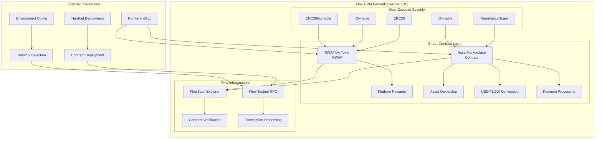
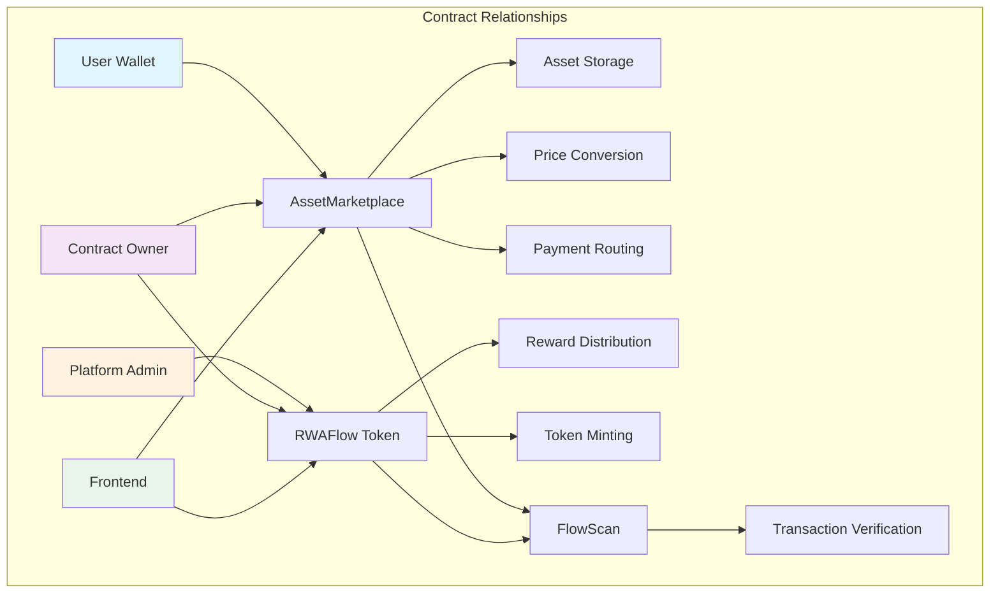
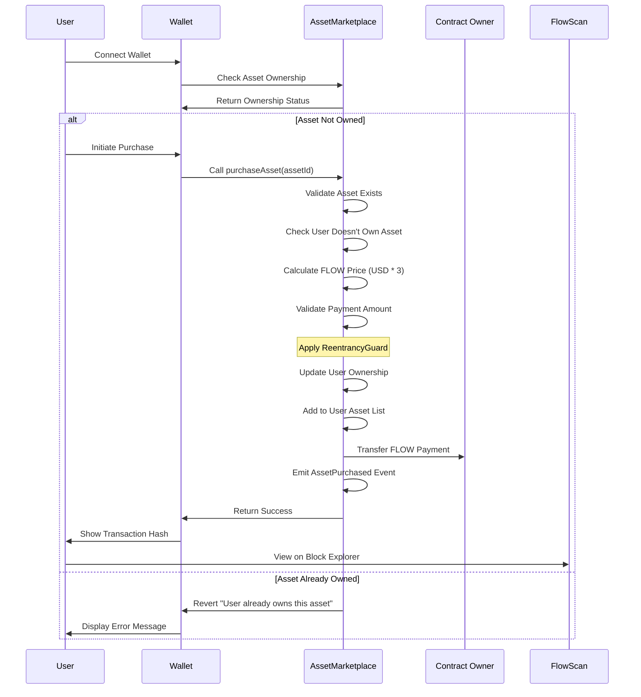
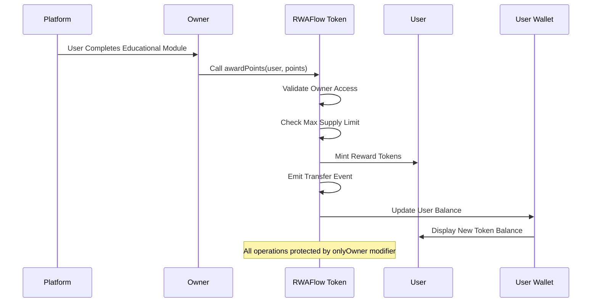
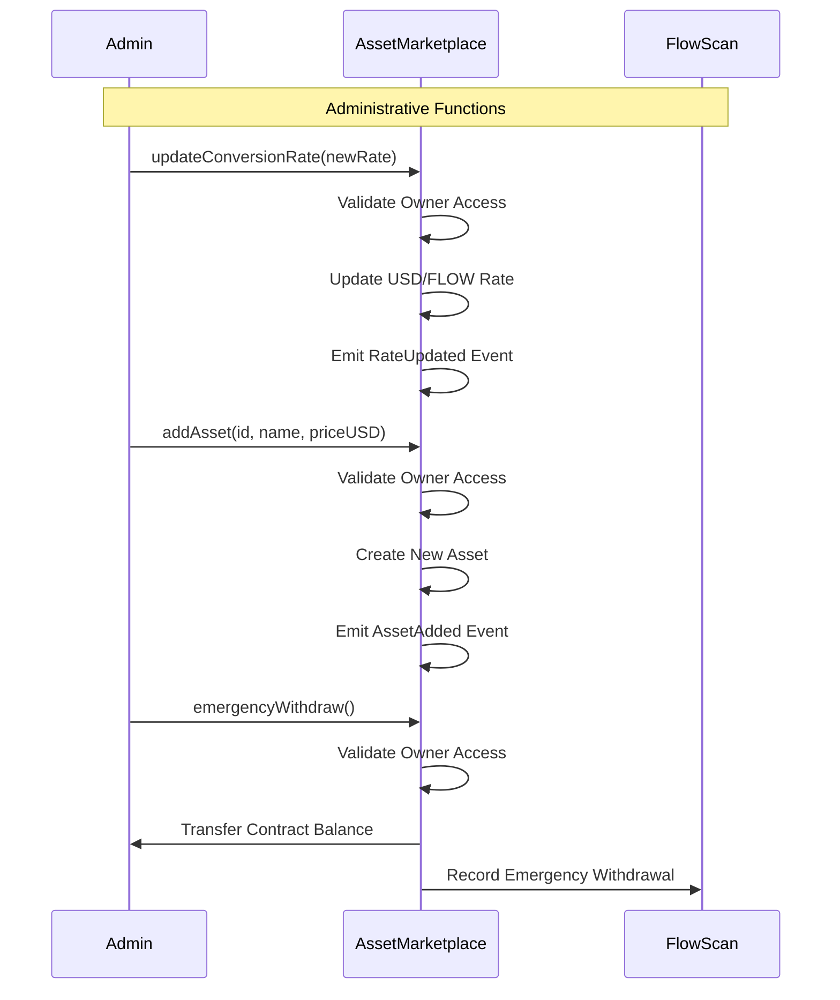

# Flow Passport Smart Contracts

Flow Passport's smart contract suite is a comprehensive **DeFi infrastructure** built on Flow EVM, featuring tokenized asset marketplace functionality and platform reward systems. The contracts are designed for secure, efficient, and scalable Real World Asset (RWA) tokenization and trading.

## 🏗️ Smart Contract Architecture

### System Architecture Overview



### Contract Interaction Architecture



## 📁 Project Structure

```
RWAFlowContracts/
├── contracts/                    # 📜 Smart Contract Source Files
│   ├── RWAFlow.sol              # 🪙 ERC20 Platform Token
│   ├── AssetMarketplace.sol     # 🏪 Original Marketplace Contract
│   └── AssetMarketplaceV2.sol   # ⚡ Enhanced Marketplace (Future)
├── scripts/                     # 🔧 Deployment & Management Scripts
│   ├── deploy.js                # 🚀 RWAFlow token deployment
│   ├── deploy-marketplace.js    # 🚀 Marketplace deployment
│   ├── verify.js                # ✅ Manual contract verification
│   ├── verify-marketplace.js    # ✅ Marketplace verification
│   ├── check-marketplace.js     # 📊 Contract status inspection
│   └── test-purchase.js         # 🧪 Asset purchase testing
├── artifacts/                   # 📦 Compiled Contract Artifacts
├── cache/                       # 💾 Compilation Cache
├── hardhat.config.js           # ⚙️ Network & Build Configuration
├── package.json                # 📋 Dependencies & Scripts
├── README.md                   # 📖 This Documentation
└── DEPLOYMENT.md               # 🚀 Deployment Guide
```

## 🎯 Smart Contract Features

### 🪙 RWAFlow Token (RWAF)
**Contract Address**: `0x6fBD4A26B44046716e37cD93Db5c47832E276AeB` (Flow Testnet)

```solidity
contract RWAFlow is ERC20, ERC20Burnable, Ownable {
    uint256 public constant MAX_SUPPLY = 1_000_000_000 * 10**18; // 1 billion
    uint256 public constant INITIAL_SUPPLY = 100_000_000 * 10**18; // 100 million
    
    function awardPoints(address user, uint256 points) external onlyOwner;
    function mint(address to, uint256 amount) external onlyOwner;
}
```

**Key Features**:
- **Max Supply Cap**: 1 billion tokens with overflow protection
- **Reward System**: Specialized `awardPoints()` for user incentives
- **Burnable Tokens**: Deflationary mechanism through token burning
- **Owner Controls**: Secure minting with access control

### 🏪 AssetMarketplace Contract  
**Contract Address**: `0xc7403912b47Bd062E1933D40027088ACD5066deD` (Flow Testnet)

```solidity
contract AssetMarketplace is Ownable, ReentrancyGuard {
    uint256 public usdToFlowRate = 3; // 1 USD = 3 FLOW
    address private constant CONTRACT_OWNER = 0xd4af2053496Da8809BF69FF2A96E86831A8b2b62;
    
    struct Asset {
        string name;
        uint256 priceUSD;
        bool exists;
    }
    
    mapping(string => Asset) public assets;
    mapping(address => mapping(string => bool)) public userAssets;
    mapping(address => string[]) public userAssetList;
}
```

**Pre-configured Assets**:
| Asset ID | Name | USD Price | FLOW Price | Type |
|----------|------|-----------|------------|------|
| 1 | Lisbon Apartment | $500 | 1,500 FLOW | Real Estate |
| 2 | NFT Art Fund | $300 | 900 FLOW | Digital Assets |
| 3 | Brazil Coffee Loan | $200 | 600 FLOW | Commodities |
| 4 | Green Energy Bond | $1,000 | 3,000 FLOW | ESG Investment |
| 5 | Corporate Debt Fund | $750 | 2,250 FLOW | Fixed Income |

## 🔄 Contract Interaction Flows

### Asset Purchase Flow



### Token Reward Distribution Flow



### Marketplace Administration Flow



## 🛠️ Technology Stack

### Core Development Framework
```json
{
  "framework": {
    "hardhat": "^2.25.0",
    "solidity": "0.8.24",
    "@nomicfoundation/hardhat-toolbox": "^6.0.0"
  }
}
```

### Security & Standards
```json
{
  "security": {
    "@openzeppelin/contracts": "^5.3.0",
    "patterns": [
      "ERC20",
      "Ownable", 
      "ReentrancyGuard",
      "ERC20Burnable"
    ]
  }
}
```

### Network Infrastructure
```json
{
  "networks": {
    "flow_testnet": {
      "chainId": 545,
      "rpc": "https://testnet.evm.nodes.onflow.org",
      "explorer": "https://evm-testnet.flowscan.io"
    },
    "flow_mainnet": {
      "chainId": 747,
      "rpc": "https://mainnet.evm.nodes.onflow.org", 
      "explorer": "https://evm.flowscan.io"
    }
  }
}
```

## 🌐 Flow EVM Network Details

### Flow Testnet Configuration
- **Chain ID**: `545`
- **Network Name**: Flow EVM Testnet
- **RPC URL**: `https://testnet.evm.nodes.onflow.org`
- **Block Explorer**: [FlowScan Testnet](https://evm-testnet.flowscan.io)
- **Currency**: FLOW
- **Faucet**: Available for testing purposes

### Flow Mainnet Configuration  
- **Chain ID**: `747`
- **Network Name**: Flow EVM Mainnet
- **RPC URL**: `https://mainnet.evm.nodes.onflow.org`
- **Block Explorer**: [FlowScan Mainnet](https://evm.flowscan.io)
- **Currency**: FLOW

### Network Features
- **EVM Compatibility**: Full Ethereum Virtual Machine support
- **High Performance**: Fast transaction processing
- **Low Fees**: Cost-effective operations
- **Developer Friendly**: Comprehensive tooling and documentation

## 🚀 Development Setup

### Prerequisites
```bash
# Node.js 18+ (v23 supported with warnings)
node --version

# Package manager
npm --version
```

### Installation & Configuration
```bash
# Clone repository
git clone <repository-url>
cd Flow-Passport/RWAFlowContracts

# Install dependencies
npm install

# Create environment file
cp .env.example .env
```

### Environment Variables
```env
# Deployment Configuration
DEPLOY_WALLET_1=your_private_key_without_0x_prefix

# Contract Verification (FlowScan)
ETHERSCAN_API_KEY=your_flowscan_api_key

# Network Selection (optional override)
NETWORK=flowTestnet
```

### Development Commands
```bash
# Compile all contracts
npm run compile

# Deploy RWAFlow token to testnet
npm run deploy:testnet

# Deploy AssetMarketplace to testnet  
npm run deploy:marketplace

# Verify contracts on FlowScan
npm run verify:marketplace <CONTRACT_ADDRESS>

# Check marketplace contract status
npm run check:marketplace

# Test asset purchase functionality
npm run test:purchase <CONTRACT_ADDRESS> <ASSET_ID>

# Run comprehensive tests
npm test
```

## 🔐 Security Architecture

### Access Control Patterns
```solidity
// Owner-only functions with OpenZeppelin Ownable
modifier onlyOwner() {
    require(owner() == _msgSender(), "Ownable: caller is not the owner");
    _;
}

// Reentrancy protection for marketplace functions
modifier nonReentrant() {
    require(_status != _ENTERED, "ReentrancyGuard: reentrant call");
    _status = _ENTERED;
    _;
    _status = _NOT_ENTERED;
}
```

### Security Features
- **ReentrancyGuard**: Prevents reentrancy attacks in marketplace
- **Supply Cap Protection**: MAX_SUPPLY enforcement prevents inflation
- **Input Validation**: Comprehensive `require()` statements
- **Safe Payment Handling**: Proper error handling for FLOW transfers
- **Event Logging**: Complete audit trail for all operations

### Security Considerations
- **Single Owner Model**: Centralized control (consider multi-sig for production)
- **Immutable Contracts**: No upgradeability mechanism
- **Hardcoded Addresses**: Contract owner address is fixed
- **Rate Limiting**: No built-in rate limiting for purchases

## 🧪 Testing & Validation

### Automated Testing Strategy
```bash
# Contract compilation verification
npm run compile

# Deployment testing on testnet
npm run deploy:marketplace

# Functional testing
npm run check:marketplace

# Purchase flow testing
npm run test:purchase 0xc7403912b47Bd062E1933D40027088ACD5066deD 1
```

### Manual Testing Procedures
```bash
# Interactive testing with Hardhat console
npx hardhat console --network flowTestnet

# Contract interaction examples
const AssetMarketplace = await hre.ethers.getContractFactory("AssetMarketplace");
const marketplace = AssetMarketplace.attach("CONTRACT_ADDRESS");

// Check asset pricing
const price = await marketplace.getAssetPriceInFLOW("1");
console.log("Price:", hre.ethers.formatEther(price), "FLOW");

// Verify ownership
const hasAsset = await marketplace.hasAsset("USER_ADDRESS", "1");
console.log("Owns Asset:", hasAsset);
```

### Test Coverage Areas
- ✅ Asset price calculations (USD to FLOW conversion)
- ✅ Ownership verification and tracking  
- ✅ Purchase transaction flows
- ✅ Access control enforcement
- ✅ Contract deployment and verification
- ✅ Event emission and logging
- ✅ Error handling and edge cases

## 📊 Gas Optimization

### Optimization Strategies
- **Efficient Data Structures**: Nested mappings for O(1) asset lookups
- **Minimal Storage Operations**: Optimized state variable usage
- **Batch Initialization**: Multiple assets configured in constructor
- **View Functions**: Gas-free queries for frontend integration

### Gas Cost Analysis
| Operation | Estimated Gas | Cost (FLOW) |
|-----------|---------------|-------------|
| Asset Purchase | ~300,000 | ~0.003 FLOW |
| Token Minting | ~50,000 | ~0.0005 FLOW |
| Price Query | 0 (view) | Free |
| Ownership Check | 0 (view) | Free |

## 🚀 Deployment Guide

### Automated Deployment Process
```bash
# Full deployment with verification
npm run deploy:marketplace

# Output example:
# 📦 Deploying AssetMarketplace...
# ✅ Contract deployed to: 0xc7403912b47Bd062E1933D40027088ACD5066deD
# ⏳ Waiting for confirmations...
# ✅ Contract verified on FlowScan
# 🎉 Deployment complete!
```

### Manual Verification (if needed)
```bash
# Verify AssetMarketplace contract
npx hardhat verify --network flowTestnet \
  0xc7403912b47Bd062E1933D40027088ACD5066deD \
  "0xd4af2053496Da8809BF69FF2A96E86831A8b2b62"

# Verify RWAFlow token  
npx hardhat verify --network flowTestnet \
  0x6fBD4A26B44046716e37cD93Db5c47832E276AeB \
  "0xd4af2053496Da8809BF69FF2A96E86831A8b2b62"
```

### Deployment Verification Checklist
- [ ] Contracts compile successfully
- [ ] Environment variables configured
- [ ] Deployment wallet has sufficient FLOW
- [ ] Network configuration matches target
- [ ] Contracts deployed and verified on FlowScan
- [ ] Asset prices configured correctly
- [ ] Owner permissions set properly
- [ ] Frontend integration tested

## 📈 Current Deployments

### Flow Testnet Contracts
| Contract | Address | Status | FlowScan |
|----------|---------|--------|----------|
| RWAFlow Token | `0x6fBD4A26B44046716e37cD93Db5c47832E276AeB` | ✅ Verified | [View](https://evm-testnet.flowscan.io/address/0x6fBD4A26B44046716e37cD93Db5c47832E276AeB) |
| AssetMarketplace | `0xc7403912b47Bd062E1933D40027088ACD5066deD` | ✅ Verified | [View](https://evm-testnet.flowscan.io/address/0xc7403912b47Bd062E1933D40027088ACD5066deD) |

### Contract Owner
- **Address**: `0xd4af2053496Da8809BF69FF2A96E86831A8b2b62`
- **Role**: Administrative control for both contracts
- **Permissions**: Token minting, asset management, rate updates

## 🔧 Troubleshooting

### Common Issues & Solutions

#### Deployment Failures
```bash
# Issue: "Insufficient funds for gas"
# Solution: Ensure wallet has enough FLOW for deployment
# Check balance: npm run check:balance

# Issue: "Network connection failed"  
# Solution: Verify Flow testnet RPC is accessible
curl -X POST https://testnet.evm.nodes.onflow.org \
  -H "Content-Type: application/json" \
  -d '{"jsonrpc":"2.0","method":"eth_blockNumber","params":[],"id":1}'
```

#### Contract Interaction Errors
```bash
# Issue: "User already owns this asset"
# Solution: Check ownership before purchase
npm run check:marketplace

# Issue: "Insufficient FLOW sent"
# Solution: Verify exact FLOW amount required
# 1 USD = 3 FLOW, so $500 asset = 1,500 FLOW
```

#### Verification Problems
```bash
# Issue: "Contract verification failed"
# Solution: Manual verification with correct parameters
npm run verify:marketplace <CONTRACT_ADDRESS>

# Check verification status on FlowScan
# Wait 1-2 minutes after deployment before verification
```

## 🤝 Contributing

### Development Guidelines
- **Solidity Version**: 0.8.24 (consistent across all contracts)
- **Code Style**: Follow OpenZeppelin patterns and conventions
- **Security**: All state-changing functions must include access control
- **Testing**: Write comprehensive tests for new functionality
- **Documentation**: Update README for any architectural changes

### Contribution Process
1. Fork the repository
2. Create feature branch (`git checkout -b feature/new-asset-type`)
3. Implement changes with tests
4. Verify contracts compile and deploy
5. Submit pull request with detailed description
6. Address code review feedback

## 📚 Additional Resources

### Flow EVM Documentation
- [Flow EVM Overview](https://developers.flow.com/evm)
- [Flow EVM Quickstart](https://developers.flow.com/evm/quickstart)
- [FlowScan Explorer Guide](https://docs.flowscan.io)

### Development Tools
- [Hardhat Documentation](https://hardhat.org/docs)
- [OpenZeppelin Contracts](https://docs.openzeppelin.com/contracts)
- [Solidity Documentation](https://docs.soliditylang.org)

### Community & Support
- **Flow Discord**: Join the Flow developer community
- **GitHub Issues**: Report bugs and request features
- **FlowScan Support**: Contract verification assistance

---

**Flow Passport Smart Contracts** - Secure, scalable infrastructure for Real World Asset tokenization on Flow EVM 🌊